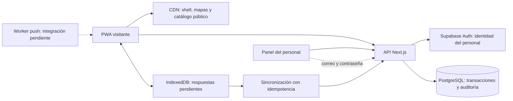

# Arquitectura y decisiones

> Referencia de la etapa Supabase. La experiencia activa es la [demo local con JSON](local-demo.md), sin conexión al backend.

## Stack acordado

Next.js con App Router y TypeScript sirve la interfaz y la API Node.js. PostgreSQL/Supabase almacena los datos y aplica las transacciones; Supabase Auth autentica exclusivamente al personal. El visitante activa un código corto y recibe una cookie opaca `HttpOnly`, `SameSite=Strict`, con `Secure` en producción. Los datos personales y la clave de servicio nunca se incluyen en el catálogo público.



La API utiliza HTTPS/PostgREST y RPC, no una conexión PostgreSQL por visitante. Todas las tablas tienen RLS y acceso directo denegado a `anon` y `authenticated`. Las operaciones de aplicación pasan por la API, que valida el rol y el propietario. Las funciones RPC solo se conceden a `service_role`; no deben exponerse con esa credencial al cliente.

## Organización

```text
src/app/                         App Router, estilos y páginas
src/app/api/[...path]/route.ts   endpoints iniciales y autorización
src/components/                 mapa, camino y formularios
src/lib/contracts.ts            validadores y contratos
src/lib/server.ts               Supabase, sesiones, hashes y límites
src/lib/offline.ts              cola persistente por participante
src/lib/campus.json             polígonos y nombres extraídos del adjunto
public/campus/                  imágenes extraídas, sin dependencias externas
public/sw.js                    shell offline y sincronización
supabase/migrations/            esquema, restricciones y funciones transaccionales
supabase/seed.example.sql        catálogo ficticio para desarrollo
tests/                          reglas de negocio e integración SQL
```

## Flujo del recorrido

1. Personal con rol de registro crea al participante, confirma que se informó sobre el uso de datos y entrega un código aleatorio de cuatro caracteres. El servidor conserva un HMAC, no el código en claro.
2. Al activar, la base registra la hora y crea una sesión de 24 horas. Los códigos de activación vencen 24 horas después del registro. Debe configurarse la duración del evento y el procedimiento de reemisión para producción.
3. El catálogo público entrega preguntas y opciones, nunca las claves de respuesta. Las especialidades requieren dos preguntas correctas (objetivo y técnica) y un código de stand válido, validado en la misma transacción.
4. Las respuestas se guardan en IndexedDB antes de enviarlas. Un UUID identifica cada operación. El servidor bloquea la fila del participante al completar un reto para evitar dobles premios entre dispositivos o reintentos.
5. Una restricción única por participante/reto impide cobrarlo dos veces. Otra por participante/solicitud detecta reutilización de un UUID con otro contenido.
6. Los premios de ruta, pares extra y encuesta tienen una clave única por origen y ordinal. Una respuesta inválida no consume el código ni genera progreso.
7. Un voto se asocia a un tiquete único; el tiquete se conserva para el sorteo.

Los formularios libres registran nombre del proyecto, nivel y descubrimiento. No demuestran por sí solos presencia física. Si se necesita ese control, debe añadirse verificación del encargado o código también a esos retos. Los códigos de stand pueden ser de un uso o compartidos con cupo; compartirlos reduce la garantía de presencia.

El mapa muestra los polígonos originales, tanto al tocar un edificio como al pulsar «Ubicación». No utiliza GPS ni calcula rutas peatonales. Las ubicaciones de Tercer Ciclo, patrocinadores y photobooth del catálogo de ejemplo requieren confirmación institucional.

## Capacidad para 2.000–4.000 visitantes

Diseño propuesto, **capacidad aún no certificada**:

- HTML, JavaScript y mapas en CDN. El catálogo es público y tiene caché CDN de 60 segundos; no contiene datos de participantes. Las respuestas privadas llevan `Cache-Control: no-store`.
- Instancias Next.js sin estado de sesión local, escalables horizontalmente. Las sesiones, límites de intentos y transacciones viven en PostgreSQL.
- Índices por participante en sesiones, asignaciones, completaciones y tiquetes; claves únicas para idempotencia y gasto de votos.
- El panel obtiene agregados cada 15 segundos. No suscribe todos los navegadores a todas las filas. Para un panel verdaderamente en vivo puede añadirse un canal agregado de Supabase Realtime.
- La cola sincroniza al reconectar y cada 30 segundos mientras la aplicación está abierta. Evitar sondeos por segundo. Antes del evento conviene introducir jitter en el sondeo para distribuir las reconexiones masivas.
- Para reportes pesados, push y sorteos programados, incorporar workers. El CSV actual se genera en memoria y es adecuado como punto de partida para el tamaño estimado; debe medirse y migrarse a trabajos asíncronos si aumentan datos o concurrencia.
- HTTPS en producción para service worker, cookies e instalación. Dominio institucional, región próxima a Costa Rica y backups con restauración probada.

El ensayo de carga debe medir 4.000 **sesiones distintas**, no únicamente 4.000 peticiones del mapa: registro desde varios puestos, activación por oleadas, avance, sincronización tras cortes y votos concurrentes. Medir p95/p99, errores, conexiones, CPU, locks y latencia de consultas. Confirmar límites y plan contratado en Supabase y el alojamiento. No se ha ejecutado esa prueba en este entorno.

## Supuestos que quedan abiertos

- Bono de encuesta propuesto: un tiquete, configurable.
- Una sola edición/evento en este esquema inicial. Para múltiples años, añadir `event_id` a participantes, reglas, premios y unicidades antes de reutilizar datos.
- Los retos y sus reglas permanecen estables tras el primer registro. La asignación congela la lista, pero no versiona el contenido de preguntas ni claves.
- Las insignias son hitos derivados en la interfaz; no tienen tabla propia ni entregan premios adicionales.
- No hay fecha de evento, agenda ni transmisión de radio inventadas. Se publican desde la configuración real.
