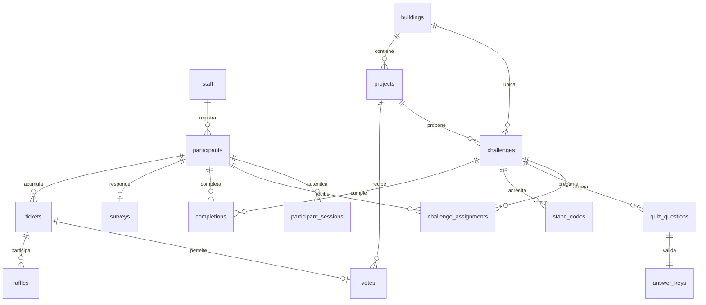

# Esquema relacional

Fuente ejecutable: [migración inicial](../supabase/migrations/202610210001_initial.sql) y [funciones administrativas](../supabase/migrations/202610210002_admin.sql). Todos los tiempos son `timestamptz`, los IDs de entidades son UUID salvo zonas del mapa y auditoría. Las claves externas y restricciones se aplican en PostgreSQL, no solo en TypeScript.

## Tablas y campos

En las siguientes tablas se muestran los tipos y restricciones tal como se declaran en SQL. `references tabla` apunta a su clave primaria. Las claves y checks compuestos se indican debajo de cada tabla.

### `settings`

| Campo | Tipo y restricciones |
|---|---|
| `id` | `boolean primary key default true check (id)` |
| `survey_bonus` | `integer not null default 1 check (survey_bonus between 0 and 10)` |
| `voting_open` | `boolean not null default true` |
| `raffle_closed` | `boolean not null default false` |
| `radio_url` | `text` |

### `staff`

| Campo | Tipo y restricciones |
|---|---|
| `user_id` | `uuid primary key references auth.users(id)` |
| `role` | `text not null check (role in ('admin','registrar','admissions','raffle'))` |
| `display_name` | `text not null` |

### `buildings`

| Campo | Tipo y restricciones |
|---|---|
| `id` | `text primary key` |
| `name` | `text not null` |
| `map_zone` | `text not null check (map_zone ~ '^[0-9]{1,2}$')` |

### `projects`

| Campo | Tipo y restricciones |
|---|---|
| `id` | `uuid primary key default gen_random_uuid()` |
| `building_id` | `text not null references public.buildings` |
| `name` | `text not null` |
| `description` | `text not null default ''` |
| `active` | `boolean not null default true` |

### `challenges`

| Campo | Tipo y restricciones |
|---|---|
| `id` | `uuid primary key default gen_random_uuid()` |
| `building_id` | `text not null references public.buildings` |
| `project_id` | `uuid references public.projects` |
| `title` | `text not null` |
| `description` | `text not null` |
| `kind` | `text not null check(kind in ('freeform','quiz_code','code','saint'))` |
| `is_base` | `boolean not null default false` |
| `badge_key` | `text check(badge_key in ('moment'))` |
| `active` | `boolean not null default false` |
| `check` | `(kind <> 'quiz_code' or project_id is not null)` |

### `quiz_questions`

| Campo | Tipo y restricciones |
|---|---|
| `id` | `uuid primary key default gen_random_uuid()` |
| `challenge_id` | `uuid not null references public.challenges` |
| `kind` | `text not null check(kind in ('objective','technical'))` |
| `prompt` | `text not null` |
| `options` | `jsonb not null check(jsonb_typeof(options)='array' and jsonb_array_length(options) between 2 and 6)` |

Restricciones: `unique(challenge_id,kind)`.

### `answer_keys`

| Campo | Tipo y restricciones |
|---|---|
| `question_id` | `uuid primary key references public.quiz_questions` |
| `correct_index` | `integer not null check(correct_index between 0 and 5)` |

### `saint_keys`

| Campo | Tipo y restricciones |
|---|---|
| `challenge_id` | `uuid primary key references public.challenges` |
| `normalized_answer` | `text not null` |

### `participants`

| Campo | Tipo y restricciones |
|---|---|
| `id` | `uuid primary key default gen_random_uuid()` |
| `kind` | `text not null check(kind in ('applicant','visitor'))` |
| `identity_number` | `text unique` |
| `name` | `text not null check(length(name) between 2 and 120)` |
| `email` | `text not null` |
| `phone` | `text` |
| `token_hash` | `text not null unique` |
| `token_expires_at` | `timestamptz not null default (now()+interval '24 hours')` |
| `created_by` | `uuid not null references public.staff(user_id)` |
| `created_at` | `timestamptz not null default now()` |
| `activated_at` | `timestamptz` |
| `route_completed_at` | `timestamptz` |
| `admission_completed_at` | `timestamptz` |
| `consent_at` | `timestamptz not null` |

Restricciones: `check(kind <> 'applicant' or identity_number is not null)`; `check(kind <> 'visitor' or phone is not null)`.

### `participant_sessions`

| Campo | Tipo y restricciones |
|---|---|
| `token_hash` | `text primary key` |
| `participant_id` | `uuid not null references public.participants on delete cascade` |
| `expires_at` | `timestamptz not null` |
| `created_at` | `timestamptz not null default now()` |

### `challenge_assignments`

| Campo | Tipo y restricciones |
|---|---|
| `participant_id` | `uuid not null references public.participants` |
| `challenge_id` | `uuid not null references public.challenges` |

Restricciones: `primary key(participant_id,challenge_id)`.

### `stand_codes`

| Campo | Tipo y restricciones |
|---|---|
| `id` | `uuid primary key default gen_random_uuid()` |
| `challenge_id` | `uuid not null references public.challenges` |
| `code_hash` | `text not null unique` |
| `expires_at` | `timestamptz not null` |
| `max_uses` | `integer not null check(max_uses>0)` |
| `uses` | `integer not null default 0 check(uses>=0 and uses<=max_uses)` |
| `created_by` | `uuid not null references public.staff(user_id)` |

### `completions`

| Campo | Tipo y restricciones |
|---|---|
| `id` | `uuid primary key default gen_random_uuid()` |
| `participant_id` | `uuid not null references public.participants` |
| `challenge_id` | `uuid not null references public.challenges` |
| `request_id` | `uuid not null` |
| `answers` | `jsonb not null` |
| `source` | `text not null check(source in ('digital','paper'))` |
| `created_at` | `timestamptz not null default now()` |

Restricciones: `unique(participant_id,challenge_id)`; `unique(participant_id,request_id)`.

### `surveys`

| Campo | Tipo y restricciones |
|---|---|
| `participant_id` | `uuid primary key references public.participants` |
| `expectations` | `text not null` |
| `satisfaction` | `integer not null check(satisfaction between 1 and 5)` |
| `interest` | `text not null` |
| `created_at` | `timestamptz not null default now()` |

### `tickets`

| Campo | Tipo y restricciones |
|---|---|
| `id` | `uuid primary key default gen_random_uuid()` |
| `participant_id` | `uuid not null references public.participants` |
| `source` | `text not null check(source in ('route','extra','survey'))` |
| `ordinal` | `integer not null check(ordinal>0)` |
| `created_at` | `timestamptz not null default now()` |

Restricciones: `unique(participant_id,source,ordinal)`.

### `votes`

| Campo | Tipo y restricciones |
|---|---|
| `ticket_id` | `uuid primary key references public.tickets` |
| `project_id` | `uuid not null references public.projects` |
| `created_at` | `timestamptz not null default now()` |

### `agenda_events`

| Campo | Tipo y restricciones |
|---|---|
| `id` | `uuid primary key default gen_random_uuid()` |
| `building_id` | `text references public.buildings` |
| `category` | `text not null check(category in ('general','pastoral','radio'))` |
| `title` | `text not null` |
| `starts_at` | `timestamptz not null` |
| `ends_at` | `timestamptz not null` |

Restricciones: `check(ends_at>starts_at)`.

### `push_subscriptions`

| Campo | Tipo y restricciones |
|---|---|
| `id` | `uuid primary key default gen_random_uuid()` |
| `participant_id` | `uuid not null references public.participants` |
| `endpoint` | `text not null unique check(endpoint like 'https://%')` |
| `keys` | `jsonb not null` |
| `created_at` | `timestamptz not null default now()` |

### `raffles`

| Campo | Tipo y restricciones |
|---|---|
| `id` | `uuid primary key default gen_random_uuid()` |
| `request_id` | `uuid not null unique` |
| `ticket_id` | `uuid not null references public.tickets` |
| `eligible_count` | `bigint not null` |
| `selected_offset` | `bigint not null` |
| `snapshot_at` | `timestamptz not null` |
| `actor_id` | `uuid not null references public.staff(user_id)` |
| `created_at` | `timestamptz not null default now()` |

### `audit_log`

| Campo | Tipo y restricciones |
|---|---|
| `id` | `bigint generated always as identity primary key` |
| `actor_id` | `uuid not null references public.staff(user_id)` |
| `action` | `text not null` |
| `subject_id` | `uuid` |
| `details` | `jsonb not null default '{}'` |
| `created_at` | `timestamptz not null default now()` |

### `rate_limits`

| Campo | Tipo y restricciones |
|---|---|
| `key` | `text primary key` |
| `window_start` | `timestamptz not null` |
| `hits` | `integer not null` |

## Estados y consistencia

- **Sin Activar:** sin `activated_at` y sin ruta completada.
- **En Proceso:** tiene `activated_at`, pero no `route_completed_at`.
- **Completado:** tiene `route_completed_at`, aunque continúe acumulando retos o falte encuesta.
- **Admisión completada:** `admission_completed_at` se establece para postulantes al recibir la encuesta con ruta ya completa.

Las funciones de completación, encuesta y voto serializan por participante mediante `FOR UPDATE`. Los códigos se bloquean al consumir cupo. El sorteo bloquea la configuración y conserva un identificador idempotente de solicitud. Las restricciones únicas evitan completaciones y premios duplicados y más de un voto por tiquete.

No hay datos de tarjeta ni fotos; el photobooth se acredita por código. Los datos personales se mantienen fuera del catálogo y las tablas de claves de respuesta no son accesibles desde el navegador.
