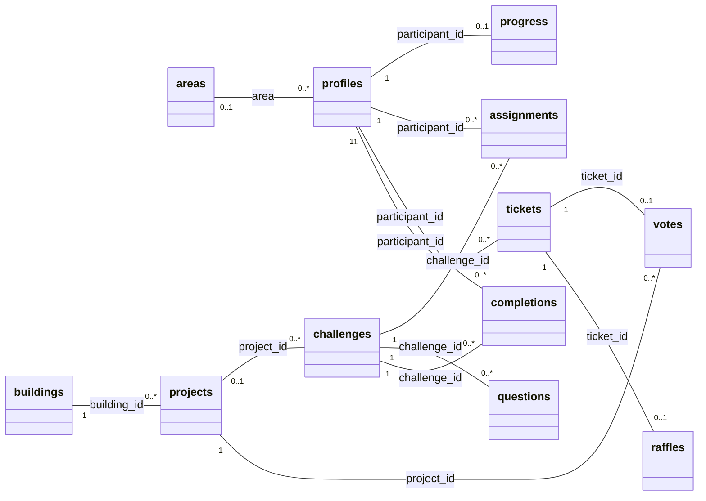

# UML de la base de datos

Modelo físico de las migraciones `202611030001_production.sql`, `202611030002_token_login.sql` `202611030003_admin_token_login.sql` y `202611030004_frontend_api.sql` en la rama `implementacionbackend`: **23 tablas en `camino`, una entidad externa `auth.users` y 30 claves foráneas**. Representa la migración implementada; no indica que ya esté desplegada en Supabase. Excluye las tablas públicas históricas del backend anterior.

- [Abrir diagrama completo SVG](database.svg): se puede ampliar sin perder nitidez y abrir en el navegador.
- [Fuente UML editable en PlantUML](database.puml): todas las columnas, tipos, claves y cardinalidades.
- [Fuente de renderizado Graphviz](database.dot): genera la imagen SVG sin enviar información a un servicio externo.

El SVG es grande porque contiene el modelo completo. El siguiente resumen permite ubicar las relaciones principales; los detalles están en el diagrama completo.



## Cómo leerlo

| Marca | Significado |
|---|---|
| PK | Clave primaria; puede estar formada por varias columnas |
| FK | Clave foránea real declarada en PostgreSQL |
| UQ | Columna única; las restricciones únicas compuestas aparecen aparte |
| `?` después del tipo | Admite NULL |
| `1` | Exactamente una entidad relacionada |
| `0..1` | Ninguna o una |
| `0..*` | Ninguna o muchas |

Las multiplicidades reflejan las restricciones SQL. Por ejemplo, el perfil tiene como máximo un progreso y una encuesta; el backend crea el progreso al registrar un participante. Un tiquete permite como máximo un voto y un sorteo ganado. Votar no elimina el tiquete: puede participar en la rifa aunque su crédito ya se utilizara.

## Grupos del modelo

| Grupo | Tablas |
|---|---|
| Identidad | `areas`, `profiles` y referencia externa a `auth.users` |
| Catálogo y configuración | `buildings`, `projects`, `challenges`, `questions`, `agenda`, `configuration` |
| Recorrido y respuestas | `progress`, `assignments`, `assignment_changes`, `completions`, `attempts`, `surveys` |
| Participación | `tickets`, `votes`, `raffles` |
| Seguridad y operación | `sessions`, `email_codes`, `mail_outbox`, `requests`, `rate_limits`, `audit` |

Los roles `admin`, `visitor` y `admission` son valores de `profiles.role`, no tablas separadas. Las especialidades se guardan en `projects.specialty`; los grados están en `projects.level`. Desarrollo Web y Ciberseguridad se relacionan con el mismo edificio TICs mediante `building_id`.

`profiles.auth_user_id` es opcional y único: se conserva para identidades administrativas heredadas. Actualmente todos los roles usan token y sesiones propias; los administradores nuevos no necesitan una cuenta Auth. En el diagrama de `auth.users` solo se muestra el ID necesario para esta relación; sus demás columnas son administradas por Supabase.

`configuration.document` conserva el catálogo y las reglas; `progress.snapshot` conserva el avance canónico. El backend sincroniza sus proyecciones SQL en transacciones. No se dibujan líneas de FK para vínculos que PostgreSQL no declara: `progress.catalog_version`, `requests.actor_id/request_id` y `audit.request_id` son referencias lógicas. `mail_outbox.envelope` está cifrado y no tiene FK a perfiles.

Las respuestas elegidas están en `completions.answers`; los fallos y su reemplazo, en `attempts`. Las respuestas correctas se guardan en `questions.correct_index`, y los códigos de retos en `challenges.code`. Son datos privados del servidor.

## Regenerar cuando cambie la migración

```bash
npm run docs:database
```

Genera `.puml` y `.dot` usando PostgreSQL embebido y leyendo su catálogo de metadatos. No necesita credenciales ni se conecta a Supabase. Para regenerar también el SVG se requiere Graphviz (`dot` disponible en PATH):

```bash
npm run docs:database -- --svg
```

La fuente PlantUML también puede abrirse con una extensión de PlantUML en VS Code. El script valida que los grupos incluyan todas las tablas; si el esquema cambia, actualizarlo junto a la migración. No modifica la base de datos de la aplicación.
