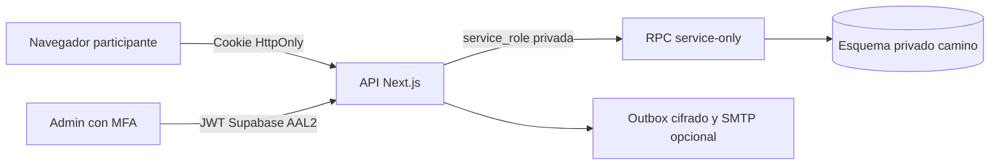

# Arquitectura y seguridad

## Límites de confianza

El navegador llama a Next.js. Next.js autentica, valida con Zod, ejecuta el mismo motor de reglas probado en la demo y realiza una RPC de Supabase. La RPC aplica el cambio en una transacción PostgreSQL. Nunca se aceptan desde participantes un rol, saldo, lista de completados, ganador, propietario o progreso arbitrario.

El esquema `camino` tiene tablas normalizadas para consultas y conserva una instantánea JSON canónica de catálogo/progreso. Esto permite reutilizar exactamente `local-game`, asignaciones, premios y evidencia histórica sin implementar otra versión de las reglas. Las proyecciones SQL (respuestas, intentos, asignaciones, tiquetes, votos) y el JSON se escriben en **una misma transacción**. No editar directamente las proyecciones: la siguiente operación las deriva del estado canónico.

Esta frontera confía en el backend. La función de commit no es una API pública para enviar progreso: aunque comprueba actor, versión, premios y monotonicidad, **no sustituye al motor de validación de respuestas del servidor**. Un robo de service_role compromete la base; RLS no protege contra esa clave. Guardarla y restringir su acceso es esencial.

## Accesos

- Participantes: código de cuatro hexadecimales público para identificación y tiquetes. Acceso secreto de 256 bits de un solo uso entregado por el administrador; su hash HMAC se guarda en perfiles. OTP opcional de ocho dígitos con HMAC, cinco intentos y diez minutos. Respuesta de solicitud de correo uniforme aunque no coincida la persona.
- Sesión opaca aleatoria en cookie `__Host-camino_session`, Secure, HttpOnly, SameSite=Strict y Path=/ en producción. SHA-256 en base; vence por defecto en doce horas. Baja, cambio de correo o reemisión revocan sesiones/credenciales previas. No se almacena el secreto en localStorage.
- Administradores: usuario real de Supabase Auth con segundo factor TOTP. El servidor consulta `auth.getUser`, comprueba issuer/sub/audience/exp/AAL2 del token ya verificado y exige perfil activo `admin` de la base en cada petición. No confía en `user_metadata` ni en un rol enviado por cliente. En producción no puede deshabilitarse MFA con una variable.
- No hay registro público de participantes. La invitación de nuevos administradores usa Auth más perfil SQL; al fallar el perfil se intenta deshacer la cuenta Auth. Como involucra dos servicios, revisar invitaciones incompletas ante un fallo de red; no es una transacción distribuida.

Los enlaces de acceso usan fragmento `#access=...` para no enviar la credencial a logs del servidor/referrers. La siguiente interfaz debe consumirlo y eliminarlo con `history.replaceState`, sin analítica ni recursos externos en ese paso. La API devuelve secretos solo al administrador que entrega el acceso. Los resultados idempotentes de alta están cifrados AES-256-GCM en la base, así como el contenido del outbox.

## Base y autorización

- Esquema no expuesto, RLS habilitado y forzado en todas sus tablas; sin acceso para roles `anon`/`authenticated`. No hay políticas que abran datos personales al navegador.
- RPC `public.camino_*` SECURITY DEFINER con search_path fijo y ejecución revocada a PUBLIC/anon/authenticated, permitida solo a service_role. Las funciones de inicialización también son privadas del servidor.
- Correo único normalizado con trim/minúsculas en perfiles, incluso en baja lógica. No se deducen ni inventan nombres o correos. Rol/área y relación especialidad/edificio/nivel tienen restricciones SQL y validación del servidor.
- UUID internos para personas; códigos cortos y códigos de tiquete únicos. Voto tiene relación única a un tiquete, impidiendo gastar dos veces su crédito. Llaves foráneas protegen respuestas, proyectos y ganadores.
- Privacidad por propietario: todas las rutas `/me` deducen al participante de su sesión. El catálogo público excluye usuarios, códigos y respuestas. Preguntas asignadas no incluyen `correctIndex`; las correcciones se revelan solo después de registrar ese fallo.

## Concurrencia y fraude

Versiones de catálogo/perfil/progreso y bloqueo por participante impiden perder actualizaciones. Los cambios de catálogo verifican todas las versiones leídas durante su validación antes de aplicar la edición; si alguien avanzó, devuelven conflicto. Los comandos del juego reintentan un conflicto hasta cuatro veces. No se recalculan rutas antiguas al editar distribución.

La clave de idempotencia es `(actor, requestId)` y guarda huella canónica del comando y resultado. Un mismo requestId con otro contenido se rechaza. La votación, emisión de premios y las proyecciones se confirman atómicamente. Completados, manuales y votos previos no se pueden borrar a través de un comando normal.

La rifa elige un índice con `crypto.randomInt` sobre todos los tiquetes activos no ganadores y verifica/bloquea el conjunto al confirmar. No usa `Math.random`, no pondera por persona y no repite tiquete ganador. No equivale a una certificación externa de sorteo; conservar el registro y reglas del evento.

## HTTP, límites y registros

Mutaciones con Origin exacto, bloqueo cross-site, cuerpos limitados por lectura incremental (16 KiB general, 256 KiB catálogo), esquemas estrictos y límites de campos. Sin CORS permisivo. Sesiones y descargas privadas no se cachean; ranking/catálogo públicos tienen caché compartida de diez segundos. Los errores no exponen SQL/stack/PII y logs de fallos inesperados solo guardan ID de traza y tipo de error.

Hay límites persistentes para activación, OTP, comandos y admin. `TRUST_PROXY=false` agrupa accesos de red sin confiar en headers falsificables; el límite de activación compartido es 3.000/minuto para admitir una red escolar. Solo habilitar TRUST_PROXY si el proveedor garantiza reemplazar x-forwarded-for. Configurar protección de abuso/WAF en el hosting y ajustar con pruebas: el límite de la aplicación no sustituye una defensa de infraestructura.

## Datos sensibles y tareas pendientes antes de producción

Recoger solo lo necesario. El registro guarda fecha de consentimiento administrativo confirmado, pero el texto/alcance legal, autorizaciones de menores, permisos del personal, conservación/borrado y atención de derechos deben acordarse con el colegio. No se afirma cumplimiento legal automático. El servidor no cifra cada nombre/correo con una clave propia porque se consultan operacionalmente; dependen de controles y cifrado en tránsito/en reposo del proveedor. Los secretos sí tienen hash/cifrado adicional. Copias Excel/JSON contienen datos personales y requieren acceso restringido.

Pendiente de verificar en el proyecto real: políticas efectivas con claves reales, flujos Supabase Auth/MFA e invitación, SMTP/dominio de correo, hostname HTTPS/cookies/proxy, recuperación de respaldos y carga. Faltan las pantallas conectadas a la API; la demo JSON contiene respuestas ficticias públicas y no es un modo seguro para datos reales.

`npm audit --omit=dev` debe revisarse antes de publicar. Se actualizó la dependencia de correo a Nodemailer 10.3.1 para corregir los avisos de la versión anterior. La cadena heredada de ExcelJS 4.4 todavía tiene avisos moderados en dependencias transitivas (glob/minimatch/uuid y archivado), sin arreglo directo compatible publicado para toda la cadena. No se expone una importación pública de Excel en esta API; no procesar respaldos de orígenes no confiables. No forzar cambios mayores transitivos sin probar lectura/escritura de respaldos.
